Getting started with Cacoa
================
Cacoa developers
2026-10-22

- <a href="#load-data" id="toc-load-data">Load data</a>
- <a href="#check-the-design" id="toc-check-the-design">Check the
  design</a>
- <a href="#screen-covariates" id="toc-screen-covariates">Screen
  covariates</a>
  - <a href="#sample-maps" id="toc-sample-maps">Sample maps</a>
- <a href="#set-the-model" id="toc-set-the-model">Set the model</a>
- <a href="#expression-shifts-per-cell-type"
  id="toc-expression-shifts-per-cell-type">Expression shifts per cell
  type</a>
  - <a href="#behind-one-cell-type" id="toc-behind-one-cell-type">Behind one
    cell type</a>
- <a href="#robustness" id="toc-robustness">Robustness</a>
- <a href="#sample-structure-after-the-model"
  id="toc-sample-structure-after-the-model">Sample structure after the
  model</a>
- <a href="#differential-expression-and-composition-on-the-same-model"
  id="toc-differential-expression-and-composition-on-the-same-model">Differential
  expression and composition on the same model</a>
- <a href="#cluster-free-analyses"
  id="toc-cluster-free-analyses">Cluster-free analyses</a>
- <a href="#functional-interpretation"
  id="toc-functional-interpretation">Functional interpretation</a>
- <a href="#session-info" id="toc-session-info">Session info</a>

Cacoa compares samples (patients, donors, replicates) across conditions.
The analysis is organized around one **model**: a formula with the
condition of interest and the covariates to adjust for, and one
**contrast**, the comparison being made. The model is set once and every
analysis uses it: expression shifts per cell type, composition,
differential expression, cell density and the cluster-free analyses.

The recommended order is

1.  `Cacoa$new()` with the sample metadata.
2.  `cao$checkDesign()`: is the planned comparison identifiable from the
    metadata alone?
3.  `cao$screenCovariates()` and `cao$plotSampleDistances()`: which
    covariates are associated with sample-level variation, in which cell
    types, and what does the sample structure look like?
4.  `cao$setModel()`: the model and the contrast used from here on.
5.  `cao$estimateExpressionShiftMagnitudes()` and the other analyses.
6.  `cao$checkSensitivity()`: does the result depend on the covariate
    set or on single samples?

This walkthrough uses a **simulated** dataset: 20 samples, 10 treated
and 10 control, and 9 cell types. Expression differences between the
arms were planted with a known strength per cell type: strong in
`IN-SST`, `IN-PV` and `L2/3`; moderate in `OPC`, `L5/6-CC` and `AST-PP`;
weak in `AST-FB`; none in `Microglia` and `Neu-NRGN`. The simulated arms
also differ in composition (not planted on purpose, but present): `L2/3`
and `L5/6-CC` are about half as frequent in the treated arm, `IN-PV` and
`IN-SST` almost twice as frequent, `AST-FB` and `OPC` somewhat more
frequent. A sample `age` was added as a covariate: the treated arm is
older on average, but age has no effect on expression in the simulation.
The same code runs on any Conos or Seurat object with a sample metadata
table.

``` r
library(cacoa)
library(ggplot2)
```

## Load data

The sample metadata is a data frame with one row per sample (row names
are the sample names) and one column per covariate.

``` r
sim <- readRDS(params$sim.file)
head(sim$sample.meta)
```

        treatment age
    S01   treated  55
    S02   control  50
    S03   treated  46
    S04   treated  55
    S05   control  48
    S06   control  52

``` r
cao <- Cacoa$new(sim$con, sample.metadata = sim$sample.meta, cell.groups = sim$cell.groups, sample.per.cell = sim$sample.per.cell,
                 n.cores = params$n.cores)
```

    Sample metadata: 20 samples, 2 columns
      usable (2): treatment [control 10, treated 10], age [num, 43-72]

    Next: cao$checkDesign() and cao$screenCovariates(), or cao$setModel(test = "<variable>").

The constructor reports which metadata columns can serve as covariates
and which cannot (sample identifiers, constant or mostly missing
columns, too many levels). Options shared by all methods are set once;
explicit arguments of a method call still win. `plot.params` holds
defaults for the embedding plots.

``` r
cao$setOptions(n.permutations = 499, seed = 1)
cao$plot.params <- list(size = 0.3, alpha = 0.3, font.size = 3)
```

## Check the design

Before fitting anything, the metadata alone tells whether the comparison
can be adjusted for the other covariates: associations between
covariates, balance of the arms over them, aliasing, degrees of freedom
and the number of distinct permutations the design allows.

``` r
cao$checkDesign(test = "treatment")
```

    Design check: 20 samples, 2 covariates, test variable 'treatment'
      association with 'treatment': age 0.34
      Note (1):
        - 'age' differs between the levels of 'treatment' (association 0.34) -> adjust for 'age' and compare with the unadjusted result (cao$checkSensitivity())

``` r
cao$plotDesign("balance")
```

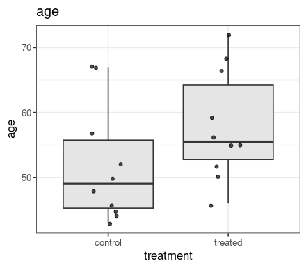<!-- -->

The treated arm is older on average, so age should be adjusted for; the
check suggests comparing the adjusted and the unadjusted result, which
`checkSensitivity()` does below.

## Screen covariates

The screen tests every usable covariate against the sample-to-sample
expression distances of each cell type, alone (marginal) and adjusted
for the other covariates (partial). Two summary columns come first: all
cell types combined and the cell-type composition. The last column is a
global test over the cell types. The screen ends with a suggested model;
it is not applied automatically.

``` r
cao$screenCovariates(n.permutations = 199)
```

    Covariate screen: 2 covariates x 9 cell types, marginal + partial mode, permutation p-values (199 permutations)
    Associated with expression in >= 2 cell types (partial, FDR 5%): treatment (7 types, global p 0.005)
    Associated with sample dispersion: treatment (2 types)
    all cell types (partial, FDR 5%): treatment (adj. R2 0.12)
    composition (partial, FDR 5%): treatment (adj. R2 0.41)
    Suggested model: ~treatment   (not applied; see cao$setModel())

``` r
cao$plotCovariateScreen()
```

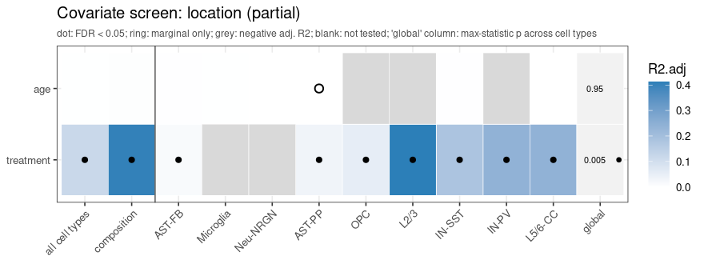<!-- -->

``` r
cao$plotVariancePartition(c("treatment", "age"))
```

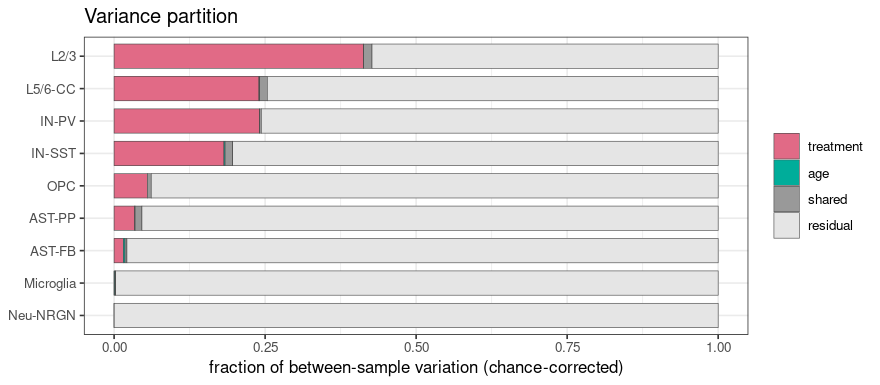<!-- -->

Treatment explains a large part of the between-sample variation in the
planted cell types and none in `Microglia` and `Neu-NRGN`; age explains
nothing, as simulated.

### Sample maps

`plotSampleDistances()` draws the samples in two dimensions (MDS of the
sample distances) in one of three spaces: `"expression"` (one cell type,
or all cell types combined when `cell.type` is not given),
`"pseudobulk"` (all cells of a sample pooled) and `"composition"`
(cell-type proportions). The subtitle gives the chance-corrected R² and
permutation p-value of each color and shape variable on its own, the
screen’s marginal numbers (its summary lines print the partial ones
where the degrees of freedom allow them). No model is needed.

``` r
cowplot::plot_grid(cao$plotSampleDistances(color.by = "treatment"),
                   cao$plotSampleDistances(space = "composition", color.by = "treatment"),
                   cao$plotSampleDistances(space = "composition", color.by = "age"), ncol = 3)
```

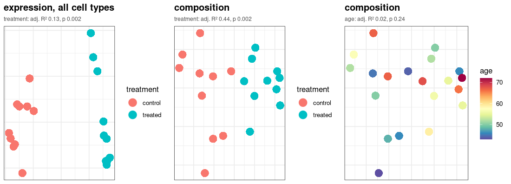<!-- -->

Over all cell types the two arms are apart (adj. R² 0.13); in the
composition they are further apart (0.44), the unplanned composition
differences described above. Age structures neither.

## Set the model

`test` names the variable to test. For a two-level factor the contrast
compares its two levels; the reference level is chosen automatically
(here `control`, matched by name) and
`test = "treatment: control vs treated"` would reverse it. The printout
states the contrast, the adjustment set and the permutation scheme.

``` r
cao$setModel(~ treatment + age, test = "treatment")
```

    Model: ~treatment + age      dispersion: ~treatment
    Test: treatment: treated vs control  (reference 'control': matched a control-like name; to change: test = "treatment: control vs treated")
           adjusted for age; permutations: freedman-lane (> 10 million distinct)
           shift > 0: treated samples differ from control samples in a common direction, beyond within-group variability
    Samples: 20 used.   Issues: 1 note
      note: test 'treatment: treated vs control': continuous covariate(s) age: using Freedman-Lane residual permutation (approximate)

## Expression shifts per cell type

For every cell type, the question is which cell types changed, and how
much. Each sample’s cells of the type are pooled into a profile, and two
things are estimated:

- **Is there a change?** For every gene, the contrast of its profile
  across the samples is divided by its standard error (sampling noise of
  the profile plus donor-level variation), and the gene z-scores are
  combined adaptively, so that both a strong change in a few genes and a
  weak change in many are detected (`statistic = "gsd"`, the default).
  Permutations of the sample labels give the p-values, adjusted across
  cell types (`padj`).
- **How big is the change?** The sample-to-sample distances of the type
  are modeled with the formula above, which gives three effects:

| effect  | meaning                                                                                                                        |
|---------|--------------------------------------------------------------------------------------------------------------------------------|
| `shift` | the arms differ in a common direction: squared distance between the arm means relative to the within-arm spread                |
| `var`   | the treated arm is more (or less) heterogeneous than the control arm: log2 ratio of the arm dispersions, at equal cell numbers |
| `total` | treated samples are farther from control samples than control samples are from each other                                      |

The normalized shift is comparable across cell types and does not depend
on the numbers of cells; `var` is tested by the distance model.

``` r
res <- cao$estimateExpressionShiftMagnitudes()
res
```

    Expression shifts: treatment: treated vs control; adjusted for age; 499 freedman-lane permutations (smallest p 0.002); statistic gsd
      celltype  n n.mag shift padj.shift   var padj.var total padj.total
          L2/3 19    17  1.59     0.0030 -0.40    0.006  1.27     0.0036
         IN-PV 20    15  0.80     0.0030  0.58    0.006  1.24     0.0036
       L5/6-CC 20    15  0.73     0.0030 -0.31    0.006  0.57     0.0036
        IN-SST 20    18  0.49     0.0030  0.11    0.660  0.55     0.0150
           OPC 20    17  0.13     0.0030  0.04    0.160  0.15     0.0036
        AST-PP 20    19  0.09     0.0030  0.02    0.310  0.10     0.0036
        AST-FB 20    16  0.04     0.0051  0.02    0.660  0.05     0.3100
     Microglia 20    19  0.00     0.6800  0.01    0.660  0.00     0.9900
      Neu-NRGN 20    19 -0.01     0.8600 -0.01    0.700 -0.01     0.7300
      7 of 9 cell types with a significant shift (BH 5%); global p: shift 0.002, var 0.002, total 0.002
      (normalized effects; full tables in $results and $wide)

``` r
cao$plotExpressionShiftMagnitudes()
```

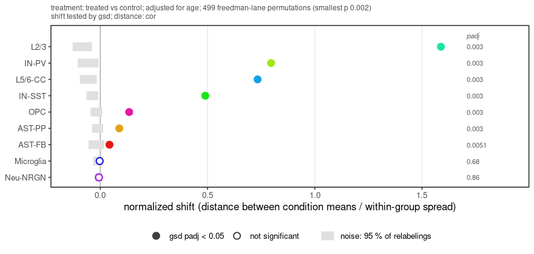<!-- -->

All seven cell types with a planted change are called, including the
weak one (`AST-FB`), and the two without a planted change are not. The
sizes follow the planted strengths only roughly (`L5/6-CC`, planted as
moderate, lies above `IN-SST`): the normalized shift measures the change
relative to each type’s own within-arm spread.

Cell types are ordered by the size of the shift; filled points have a
significant change. The gray band is the range of the shift with
shuffled labels (what noise alone gives). Significance and size answer
different questions: a small but consistent change can be significant,
and a large estimate based on few or heterogeneous samples may not be.
The jackknife intervals (`show.ci = TRUE`) show how firmly the samples
determine the size; they are not a test. The genes changed at a
gene-level FDR can be added as a margin (`show.genes = TRUE`); their
number depends on the numbers of samples and cells, so it is a
cross-check rather than a ranking.

``` r
cao$plotExpressionShiftMagnitudes(show.ci = TRUE, show.genes = TRUE)
```

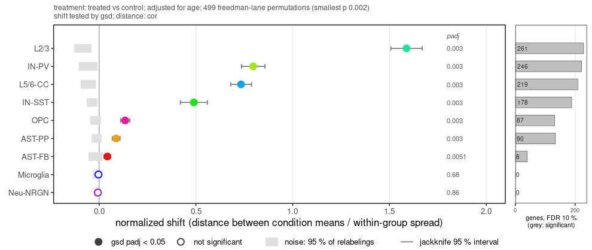<!-- -->

The dispersion change, on the same layout:

``` r
cao$plotExpressionShiftMagnitudes(effect = "var")
```

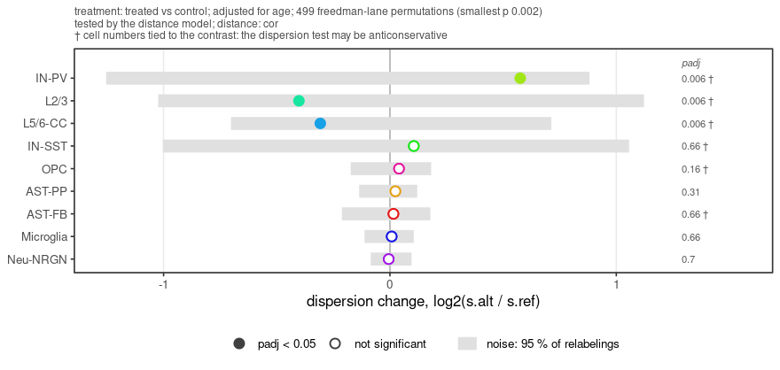<!-- -->

### Behind one cell type

`plotShiftDetail()` shows the sample-level picture of the distance model
for one cell type: the samples in the adjusted distance space, the
distribution of pair distances within and between the arms, and the
per-sample dispersion.

``` r
cao$plotShiftDetail("IN-SST")
```

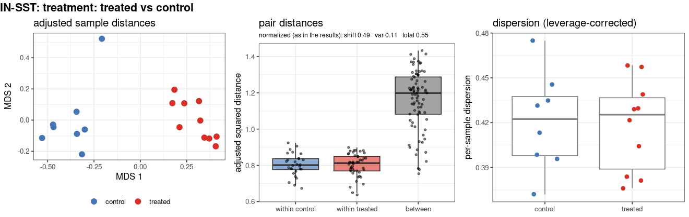<!-- -->

`plotSampleInfluence()` shows how much each sample changes the shift
estimate of each cell type when it is left out, in units of the
jackknife standard error.

``` r
cao$plotSampleInfluence()
```

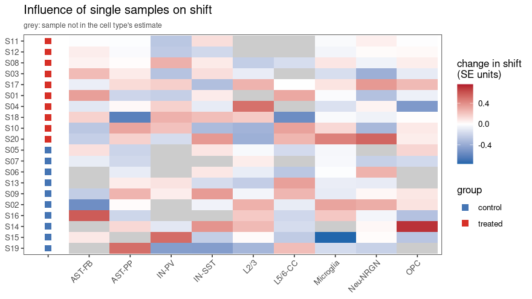<!-- -->

## Robustness

The shifts are re-estimated without adjustment, with the current model,
and with the covariates proposed by the screen, and two questions are
answered per cell type. The size (the distance-model magnitude, as in
the main result): near zero (inside the noise band of shuffled labels),
stable, changing by more than half, sign depending on the model, or
driven by one sample. The significance (by gsd, the test of the main
result, refitted under each model): significant in all, some or none of
the models.

``` r
cao$checkSensitivity(n.permutations = 199)
```

    Sensitivity of 'treatment: treated vs control' (shift) across 2 models: unadjusted [~treatment]; current [~treatment + age]
      magnitude: distance model; significance: gsd (adjusted p < 0.05)
      L2/3      magnitude stable; significant in all 2 models
      IN-PV     magnitude stable; significant in all 2 models
      L5/6-CC   magnitude stable; significant in all 2 models
      IN-SST    magnitude stable; significant in all 2 models
      OPC       magnitude stable; significant in all 2 models
      AST-PP    magnitude stable; significant in all 2 models
      AST-FB    magnitude stable; significant in all 2 models
      Neu-NRGN  magnitude near zero (within the relabeling band); not significant in any of 2 models
      Microglia magnitude near zero (within the relabeling band); not significant in any of 2 models

``` r
cao$plotSensitivity()
```

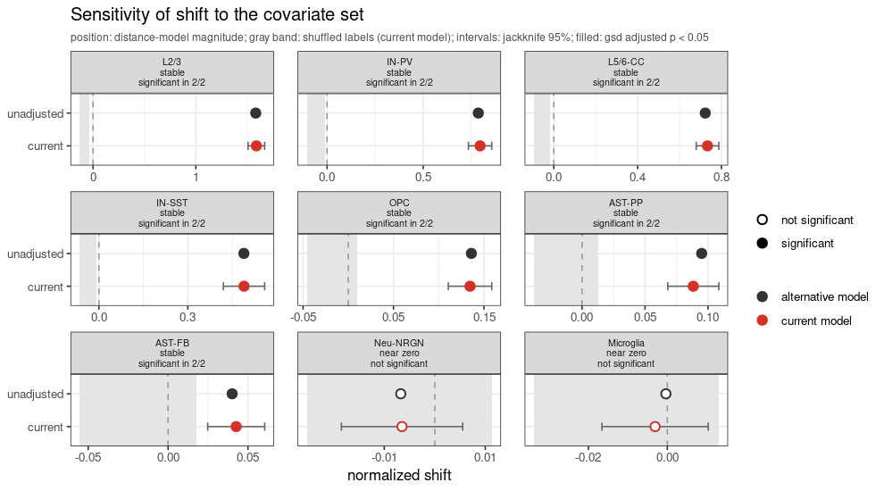<!-- -->

Adjusting for age changes nothing here: the seven changed cell types are
significant with and without it, and the two unchanged ones in neither
model.

## Sample structure after the model

Once a model is set, the maps can also be drawn with its covariates
removed (`values = "adjusted"`, or `"both"` side by side): a covariate
that was adjusted for should no longer structure the samples.

``` r
cao$plotSampleDistances(cell.type = "IN-SST", values = "both", color.by = "age", shape.by = "test")
```

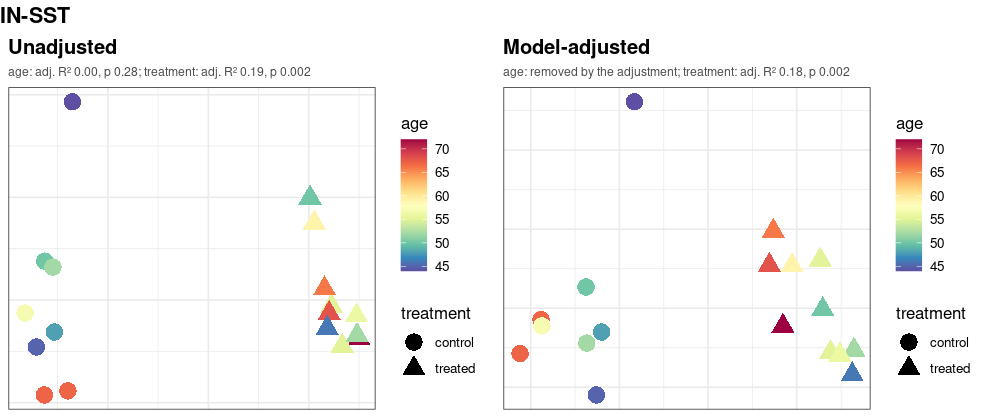<!-- -->

## Differential expression and composition on the same model

The stored model is used by the per-cell-type differential expression,
by the compositional analysis and by the cell density analysis, and is
recorded with each result.

``` r
de <- cao$estimateDEPerCellType(test = "limma-voom", min.cell.count = 5)
head(de[["IN-SST"]]$res[, c("Gene", "log2FoldChange", "pvalue", "padj", "CellFrac")])
```

                 Gene log2FoldChange       pvalue         padj CellFrac
    Gene2526 Gene2526       4.361246 3.203458e-20 1.601729e-16        1
    Gene2241 Gene2241       1.905464 3.430325e-16 8.575812e-13        1
    Gene2406 Gene2406       4.651184 1.506736e-15 2.511226e-12        1
    Gene3125 Gene3125       2.883402 2.364898e-15 2.956122e-12        1
    Gene900   Gene900       3.619318 6.012397e-15 6.012397e-12        1
    Gene2256 Gene2256       2.728537 1.859654e-13 1.549712e-10        1

``` r
cao$plotNumberOfDEGenes()
```

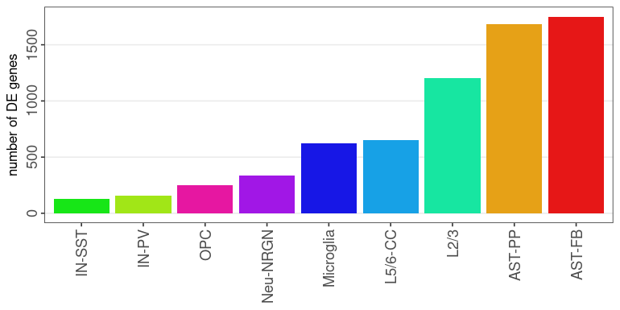<!-- -->

Compositional changes are tested on the same contrast (cell-type
loadings of the treated versus the control arm):

``` r
cao$estimateCellLoadings()
cao$plotCellLoadings()
```

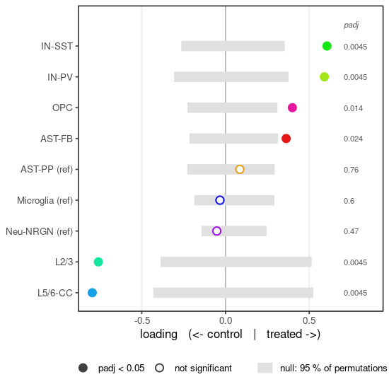<!-- -->

## Cluster-free analyses

Cell density is compared between the arms in every cell’s neighborhood
with the same model. The unit is a kNN neighborhood of the cell graph:
the cell, its graph neighbors and, up to a minimum size, their
neighbors, sized by default to the larger of 100 cells and 10 cells per
sample (`k`). Each sample’s share of the neighborhood’s cells is tested
on the log scale, and the statistic is then averaged over each cell and
its graph neighbors under every permutation alike (`post = "averaged"`),
an exact test of a slightly larger unit that borrows strength from the
neighbors without inflating the error. The per-cell statistics are
strongly dependent and permutation p-values are floored at 1 /
(permutations + 1), so the maps are adjusted by a pooled permutation
false-discovery rate (`adjust.method = "perm-fdr"`): the number of cells
beyond a threshold under the permutations, pooled over all cells,
against the observed number. The heat-kernel density
(`smoothing = "heat"`, width in cells with `target.size`),
Benjamini-Hochberg on per-cell p-values (`"bh"`) and the familywise
max-statistic adjustment (`"max-t"`) remain available. The cluster-free
expression shifts test the contrast in the same kNN neighborhoods with
the same post-processing and adjustment.

Before the density test, the neighborhood unit is checked: how many
cells each sample contributes to a unit, how large the units are, and
how pure they are against the annotation.

``` r
nb <- cao$checkNeighbourhoods(verbose = FALSE); cat(nb$text, "\n")
```

    kNN units of 100 cells (median size 345): a sample contributes 17 cells to a unit (median), 1% of the unit-sample pairs have fewer than 3 cells; median purity 0.85 against the annotation (lowest: Microglia, AST-FB, L5/6-CC) 

``` r
cao$estimateCellDensity(method = "graph")
cao$estimateDiffCellDensity(type = "permutation")
cowplot::plot_grid(cao$plotDiffCellDensity(what = "effect", contours = "L2/3"), cao$plotDiffCellDensity(adjust = FALSE),
                   cao$plotDiffCellDensity(adjust = TRUE), ncol = 3)
```

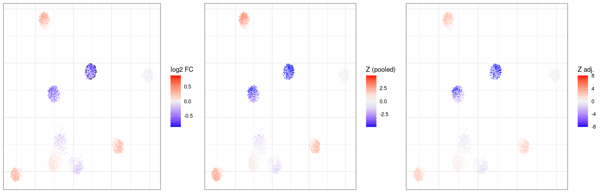<!-- -->

Left to right: the effect (the log2 fold change of the density per
cell), the unadjusted z-scores (the signed tail z of the per-cell
p-values of the pooled permutation null, calibrated and not floored at 1
/ (permutations + 1)) and the adjusted z-scores (the tail z of the FDR
q-values). The color range of a z map is the 99.5 % quantile of the
absolute z-scores, so a few extreme cells do not wash out the map. The
density map agrees with the loadings: `L2/3` and `L5/6-CC` are depleted
in the treated arm, `IN-PV`, `IN-SST` and `OPC` enriched. The expression
shifts show the planted cell types, again as the shift magnitude, the
unadjusted and the adjusted z-scores (one-sided):

``` r
cao$estimateClusterFreeExpressionShifts(n.permutations = 99)
cao$plotClusterFreeExpressionShifts(font.size = 3)
```

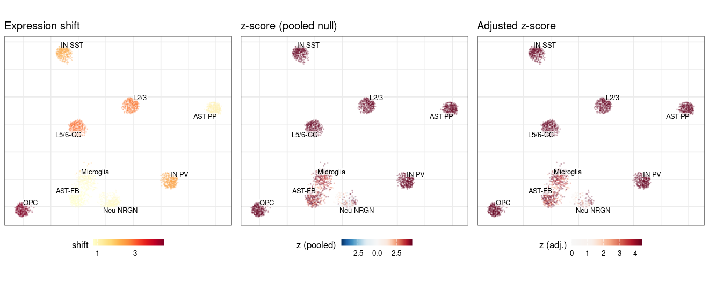<!-- -->

The map also calls the microglia, which carry no planted change (and
part of `Neu-NRGN`), while the per-type test does not (adjusted p 0.68).
The three types form one cloud on the graph: 40 % of the cells in a
microglial neighborhood belong to other types, mostly `AST-FB` (21 %)
and the strongly changed `L5/6-CC` and `L2/3` (9 %). The map reports a
neighborhood effect there, the risk of any test that borrows neighboring
cells across cell-type boundaries; the per-type test and
`checkNeighbourhoods()` (purity of the units) are the checks.

Both cluster-free maps are summarized per cell type by an exact
group-level permutation test: the mean per-cell statistic of the type is
compared with the same mean under the permutations shared by all cells,
so the dependence between neighboring cells is carried along, and the
result is adjusted across types. This gives a verdict per type where the
per-cell map is too sparse to call single cells (a Cauchy combination of
the cells’ p-values is the alternative, `method = "cauchy"`).

``` r
cao$estimateClusterFreeSummary("cell.density")
cao$estimateClusterFreeSummary("cluster.free.expr.shifts")
cowplot::plot_grid(cao$plotClusterFreeSummary("cell.density"), cao$plotClusterFreeSummary("cluster.free.expr.shifts"), ncol = 2)
```

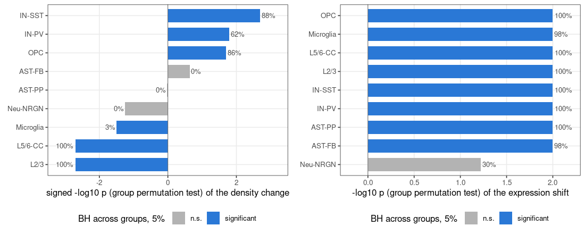<!-- -->

The density summary recovers the composition differences of the
simulation and the shift summary the planted cell types. `Microglia` is
also called by the shift summary although nothing was planted there: its
neighborhoods border `AST-FB`, whose frequency differs between the arms,
so the neighborhood profiles shift with the composition. The
per-cell-type test above, which pools the cells of a type, puts
`Microglia` at zero; a neighborhood-level expression test cannot
separate the two.

## Functional interpretation

The DE tables feed a gene set enrichment analysis per cell type (GSEA on
GO biological processes, through clusterProfiler), and the enriched
terms are summarized by grouping related terms: terms are first
clustered by the genes they share, then by their enrichment pattern
across cell types, and each cluster is labeled by its most frequent
words. The simulated genes have no annotation, so the chunks below are
shown but not run; see the real-data examples in `examples/` for
executed versions.

``` r
cao$estimateOntology(type = "GSEA", org.db = org.Hs.eg.db::org.Hs.eg.db)
cao$plotOntologyHeatmapCollapsed(name = "GSEA", genes = "up", n = 25, clust.method = "ward.D")
cao$plotOntology(cell.type = "IN-SST", name = "GSEA", genes = "up")
```

## Session info

``` r
sessionInfo()
```

    R version 4.2.2 Patched (2022-11-10 r83330)
    Platform: x86_64-pc-linux-gnu (64-bit)
    Running under: Ubuntu 20.04.6 LTS

    Matrix products: default
    BLAS:   /usr/lib/x86_64-linux-gnu/blas/libblas.so.3.9.0
    LAPACK: /usr/lib/x86_64-linux-gnu/lapack/liblapack.so.3.9.0

    locale:
     [1] LC_CTYPE=en_US.UTF-8       LC_NUMERIC=C              
     [3] LC_TIME=en_US.UTF-8        LC_COLLATE=en_US.UTF-8    
     [5] LC_MONETARY=en_US.UTF-8    LC_MESSAGES=en_US.UTF-8   
     [7] LC_PAPER=en_US.UTF-8       LC_NAME=C                 
     [9] LC_ADDRESS=C               LC_TELEPHONE=C            
    [11] LC_MEASUREMENT=en_US.UTF-8 LC_IDENTIFICATION=C       

    attached base packages:
    [1] stats     graphics  grDevices utils     datasets  methods   base     

    other attached packages:
    [1] ggplot2_4.0.2  cacoa_0.5.0    Matrix_1.6-1.1

    loaded via a namespace (and not attached):
      [1] spatstat.univar_3.1-4       circlize_0.4.16            
      [3] plyr_1.8.9                  igraph_2.1.4               
      [5] lazyeval_0.2.2              sp_2.2-0                   
      [7] splines_4.2.2               BiocParallel_1.32.6        
      [9] listenv_0.9.1               scattermore_1.2            
     [11] GenomeInfoDb_1.34.9         digest_0.6.37              
     [13] foreach_1.5.2               htmltools_0.5.8.1          
     [15] memoise_2.0.1               magrittr_2.0.3             
     [17] tensor_1.5.1                cluster_2.1.4              
     [19] doParallel_1.0.17           ks_1.15.1                  
     [21] ROCR_1.0-11                 limma_3.54.2               
     [23] Biostrings_2.66.0           annotate_1.76.0            
     [25] ComplexHeatmap_2.14.0       globals_0.18.0             
     [27] matrixStats_1.5.0           spatstat.sparse_3.1-0      
     [29] sccore_1.0.6                colorspace_2.1-0           
     [31] blob_1.2.4                  ggrepel_0.9.6              
     [33] xfun_0.53                   dplyr_1.1.4                
     [35] crayon_1.5.2                RCurl_1.98-1.12            
     [37] jsonlite_2.0.0              progressr_0.15.1           
     [39] spatstat.data_3.1-8         survival_3.4-0             
     [41] zoo_1.8-14                  iterators_1.0.14           
     [43] ape_5.8-1                   glue_1.8.0                 
     [45] polyclip_1.10-7             gtable_0.3.6               
     [47] zlibbioc_1.44.0             XVector_0.38.0             
     [49] leiden_0.4.3                DelayedArray_0.24.0        
     [51] GetoptLong_1.0.5            leidenAlg_1.1.5            
     [53] future.apply_1.20.0         shape_1.4.6.1              
     [55] BiocGenerics_0.44.0         abind_1.4-8                
     [57] scales_1.4.0                mvtnorm_1.3-3              
     [59] DBI_1.1.3                   spatstat.random_3.4-1      
     [61] miniUI_0.1.2                Rcpp_1.1.0                 
     [63] coda.base_1.0.3             viridisLite_0.4.2          
     [65] xtable_1.8-4                clue_0.3-65                
     [67] reticulate_1.43.0           mclust_6.1.1               
     [69] bit_4.6.0                   stats4_4.2.2               
     [71] htmlwidgets_1.6.4           httr_1.4.7                 
     [73] RColorBrewer_1.1-3          Seurat_4.3.0.1             
     [75] ica_1.0-3                   XML_3.99-0.14              
     [77] pkgconfig_2.0.3             farver_2.1.2               
     [79] uwot_0.2.3                  deldir_2.0-4               
     [81] locfit_1.5-9.8              AnnotationDbi_1.60.2       
     [83] tidyselect_1.2.1            labeling_0.4.3             
     [85] rlang_1.1.7                 reshape2_1.4.4             
     [87] later_1.4.4                 cachem_1.1.0               
     [89] pbmcapply_1.5.1             tools_4.2.2                
     [91] cli_3.6.5                   RSQLite_2.3.1              
     [93] generics_0.1.4              ggridges_0.5.7             
     [95] evaluate_1.0.5              stringr_1.5.1              
     [97] fastmap_1.2.0               yaml_2.3.10                
     [99] goftest_1.2-3               bit64_4.6.0-1              
    [101] knitr_1.50                  fitdistrplus_1.2-4         
    [103] purrr_1.1.0                 RANN_2.6.2                 
    [105] KEGGREST_1.38.0             pbapply_1.7-4              
    [107] future_1.67.0               nlme_3.1-161               
    [109] mime_0.13                   pracma_2.4.4               
    [111] compiler_4.2.2              plotly_4.11.0              
    [113] png_0.1-8                   spatstat.utils_3.1-5       
    [115] geneplotter_1.76.0          tibble_3.3.0               
    [117] stringi_1.8.7               lattice_0.20-45            
    [119] psych_2.5.6                 vctrs_0.6.5                
    [121] pillar_1.11.0               lifecycle_1.0.4            
    [123] spatstat.geom_3.5-0         lmtest_0.9-40              
    [125] GlobalOptions_0.1.2         RcppAnnoy_0.0.22           
    [127] bitops_1.0-9                data.table_1.17.8          
    [129] cowplot_1.2.0               irlba_2.3.5.1              
    [131] httpuv_1.6.16               patchwork_1.3.2            
    [133] conos_1.5.4                 GenomicRanges_1.50.2       
    [135] R6_2.6.1                    promises_1.3.3             
    [137] KernSmooth_2.23-20          gridExtra_2.3              
    [139] IRanges_2.32.0              parallelly_1.45.1          
    [141] codetools_0.2-18            MASS_7.3-58                
    [143] SummarizedExperiment_1.28.0 DESeq2_1.38.3              
    [145] rjson_0.2.21                withr_3.0.2                
    [147] SeuratObject_4.1.3          mnormt_2.1.1               
    [149] sctransform_0.4.2           GenomeInfoDbData_1.2.9     
    [151] S4Vectors_0.36.2            parallel_4.2.2             
    [153] grid_4.2.2                  tidyr_1.3.1                
    [155] rmarkdown_2.29              MatrixGenerics_1.10.0      
    [157] S7_0.2.0                    Rtsne_0.17                 
    [159] spatstat.explore_3.5-2      Biobase_2.58.0             
    [161] shiny_1.11.1               
